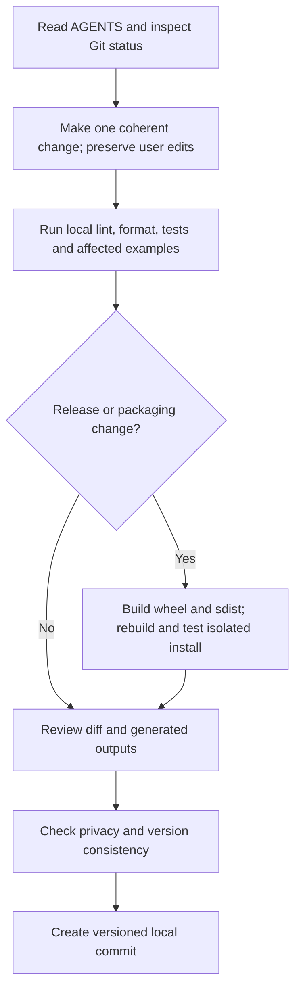

# Contributing

Thank you for improving the standalone FiggieJAX engine. Keep changes focused
on the simulator, its optional adapters, examples, and their documentation.

## Development setup

Use Python 3.12 and uv. Install development dependencies with:

```bash
uv sync --locked
```

For cloning, uv installation, runtime-only setup, and platform scope, see
[installation](docs/installation.md).

For adapter changes, install the optional CPU integrations:

```bash
uv sync --locked --extra all
```

## Code and behavior

- Keep simulator transitions pure, fixed-shape, and compatible with JAX `jit`,
  `vmap`, and `lax.scan`.
- Pass explicit random keys. Keep host I/O and NumPy conversion out of compiled
  engine transitions.
- Give decentralized actors only `observe` output. Keep privileged critic
  inputs separate and explicit.
- Keep Gymnasium, PettingZoo, and OpenSpiel dependencies optional. Do not import
  them from the core engine or from the adapter package initializer.
- Preserve four- and five-seat support, independent clocks, stale-quote checks,
  fractional pot shares, and distinct termination and truncation behavior.
- Treat unpublished exchange details as simulation choices. Do not describe an
  assumption as an official rule.
- Keep examples small and seeded. Label all generated game outcomes as
  simulations. Do not present them as evidence of strategic strength.
- Add useful type hints and Google-style docstrings. Format Python with Ruff.
- Update user-facing documentation when commands, behavior, configuration, or
  limitations change. Record intentional dependency changes in `uv.lock`.

## Validation

Run checks that match the change:

```bash
uv run pytest
uv run ruff check .
uv run ruff format --check .
```

For release and adapter changes, run:

```bash
uv sync --locked --extra all
uv run python scripts/validate_release.py --with-adapters
```

The release validator builds and inspects both distributions, installs the wheel
in an isolated environment, runs bounded example games, and records artifact
hashes under `results/`. It does not publish a package. CPU checks do not
validate GPU behavior or performance.



Keep GitHub for source storage. Do not add hosted CI, required pull requests,
or branch-protection steps. Review and commit locally. Push only when the user
explicitly requests it. Never rewrite history or force-push without authorization.

Keep generated replays, metrics, and checkpoints in the ignored `results/`
directory. Do not add credentials, private data, or large model files. Preserve
the MIT license and `NOTICE.md`.

## Release metadata

Keep `pyproject.toml`, `uv.lock`, `src/figgie_jax/__init__.py`, `README.md`,
`CITATION.cff`, and `CHANGELOG.md` on the same release version. Keep
`SOURCE.json` as initial-export provenance; use Git history for changes made
after export. See [the setup skill](.agents/skills/setup-figgie-engine/SKILL.md)
for environment and package guidance.
