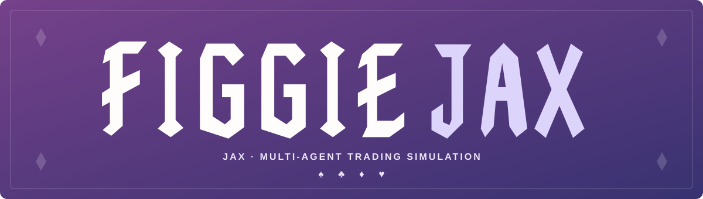
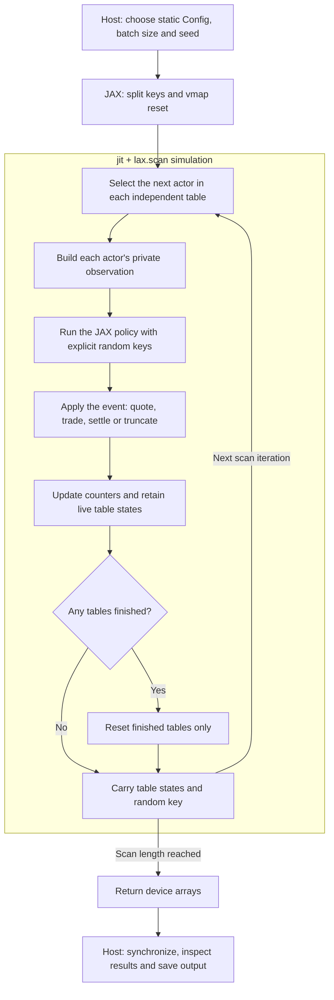
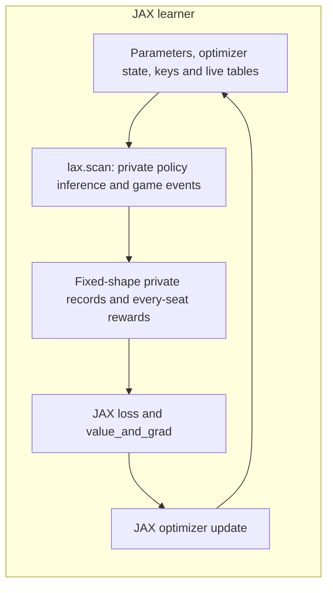
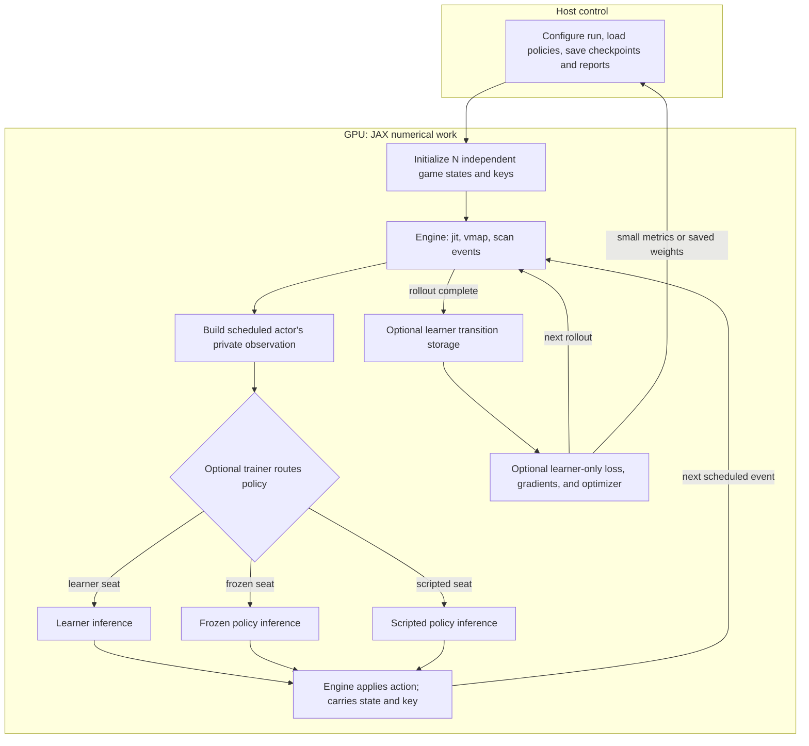
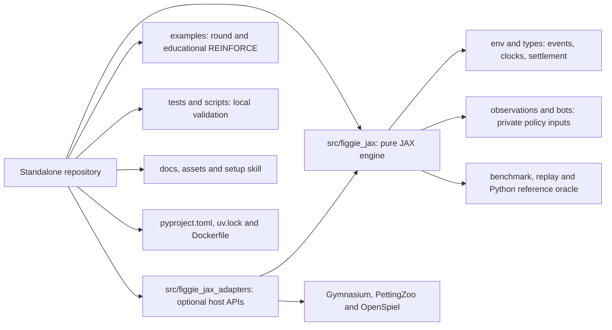

<p align="center"></p>

# FiggieJAX Engine

A standalone, event-driven Figgie simulator for four or five players. It uses
pure JAX transitions, private observations, independent seat clocks, and explicit
random keys. Version **0.16.1** includes optional Gymnasium, PettingZoo, and
OpenSpiel adapters, native game examples, portable JSON replays, a Python rules
oracle, and an engine benchmark.

Game trajectories and example learning outputs are simulations. They are not
empirical market data. The short REINFORCE example demonstrates a parameter
update. It does not measure strategic strength. This project is independent of
Jane Street. See [NOTICE.md](NOTICE.md).

Start with [installation and platform scope](docs/installation.md) for cloning,
uv installation, runtime versus development environments, and use from another
project. For learning integration, read [parallel collection](docs/parallel-collection.md).
GitHub stores source only. Validation and versioned commits stay local.

## Run the simulation loop fully in JAX

The complete simulation event loop can run as one compiled JAX computation.
This includes scheduling, private observations, scripted policy decisions,
trades, settlement, and resets of finished tables. Python handles configuration,
the compiled call, and output. There is no Python or NumPy work per event inside
the compiled loop. JAX can execute this path on CPU or a supported NVIDIA GPU.

Choose the execution path that fits the application:

| Path | Event-loop execution | Purpose |
| --- | --- | --- |
| `benchmark.make_rollout` | JAX `jit`, `vmap`, and `lax.scan` | Batched device simulation with scripted agents |
| `examples/rollout.py` | Python orchestration of JAX operations | Readable complete-round example |
| `examples/train_reinforce.py` | Python collection with JAX policy math and gradients | Educational learning example |
| `examples/train_jax.py` | JAX collection, gradients, and repeated updates in one `jit` | Compiled educational agent training |
| Optional framework adapters | Python host API around the JAX engine | Gymnasium, PettingZoo, and OpenSpiel interoperability |

Here, "fully in JAX" describes the simulation's computational loop. File I/O,
argument parsing, and reporting remain host operations. The optional adapters
are not required for this path.



`vmap` batches independent tables. It does not make all seats act simultaneously.
Each table keeps the engine's independent seat clocks and quote checks.

### Run a compiled batch

Install only the runtime dependencies with `uv sync --locked --no-dev`. Run the following
Python example with `uv run --no-sync python` or save it as a local script. It needs no
Gymnasium, PettingZoo, OpenSpiel, or optimizer package.

```python
from functools import partial

import jax

from figgie_jax.benchmark import make_rollout
from figgie_jax.env import reset
from figgie_jax.types import Config

config = Config(num_players=4, duration_ms=1000)
batch_size = 32
steps = 64
policy_key, deal_key = jax.random.split(jax.random.key(7))

# Configuration and array shapes are fixed when these functions compile.
reset_batch = jax.jit(jax.vmap(partial(reset, config=config)))
states = reset_batch(jax.random.split(deal_key, batch_size))
run = make_rollout(config, steps)

# Scheduling, private observations, policies, events and resets run in JAX.
states, policy_key, counts = jax.block_until_ready(run(states, policy_key))

# Host conversion happens only after the compiled batch has finished.
opportunities, trades, completed_rounds, truncations = map(int, jax.device_get(counts))
if truncations:
    raise RuntimeError("The batch hit the event safety cap; these are incomplete games.")
print(
    {
        "backend": jax.default_backend(),
        "devices": [str(device) for device in jax.devices()],
        "simulated_opportunities": opportunities,
        "simulated_trades": trades,
        "completed_rounds": completed_rounds,
        "truncations": truncations,
    }
)
```

The seed is 7. This example runs 32 four-seat tables for 64 opportunities per
table. Its 1,000 ms rounds are a short simulation setting. They are not the
standard 240-second game. Use `num_players=5` to compile a five-seat batch.
Changing configuration, batch size, or scan length can require compilation again.

`make_rollout` returns the next table states, the next random key, and counters
for this call. Pass the returned states and key into the next call to continue.
An unfinished table stays live across calls. Finished tables reset to fresh
bankrolls. These are independent rounds, not a cumulative-bankroll match.
Truncations are counted without a payout; reject them as incomplete simulations.

### Run the compiled path in Docker

For a small Linux CPU smoke check:

```bash
mkdir -p results
docker build --target runtime -t figgie-engine:runtime .
docker run --rm -v "$PWD/results:/results" figgie-engine:runtime \
  uv run --no-sync figgie-engine-benchmark --backend cpu \
  --batch 32 --steps 64 --repeats 1 --seed 7 --output /results/jax-cpu-smoke.json
```

On Linux x86-64 with a compatible NVIDIA driver and NVIDIA Container Toolkit:

```bash
docker build --target gpu -t figgie-engine:gpu .
docker run --rm --gpus device=0 -v "$PWD/results:/results" figgie-engine:gpu \
  uv run --no-sync figgie-engine-benchmark --backend gpu \
  --batch 32 --steps 64 --repeats 1 --seed 7 --output /results/jax-gpu-smoke.json
```

The GPU image sets `JAX_PLATFORMS=cuda`. The benchmark also checks the requested
backend, so it cannot silently accept a CPU run as a GPU run. These commands
exercise the same compiled collector as the Python example, but use the
benchmark's standard round duration. A short smoke run may finish no rounds.
Its timing is a smoke check, not a throughput result to publish. Docker Desktop
CPU checks do not validate CUDA.

### Use the JAX path for reinforcement learning

The compiled collector above uses `heuristic_policy`. It returns counters and
live states; it does not retain a training trajectory or update a learner.
The original `train_reinforce.py` example uses host collection. The
`train_jax.py` example compiles complete-round collection, masked linear policy
inference, REINFORCE gradients, and repeated SGD updates together. See the
[compiled learning guide](docs/compiled-learning.md) for Docker GPU validation
and training commands. This small example has no production league or PPO system.

The following architecture also applies when extending the educational learner:



1. Keep model parameters, optimizer state, policy memory, PRNG keys, and table
   states in fixed-shape JAX pytrees. Close over a static `Config`.
2. Inside each event, call `observe` for the selected seat. Use the pure JAX
   `relative_features`, `action_masks`, and `price_mask` functions. Feed only the
   private observation to the actor. Keep privileged critic inputs separate.
3. Construct the structured `Action` from JAX scalar arrays. Do not call the
   NumPy-based `figgie_jax_adapters.common` helpers inside a compiled collector.
4. Retain observations, actions, masks, and `Transition.rewards` in fixed-shape
   rollout buffers before any automatic reset. Accumulate the learner's reward
   across all events, including settlement on another seat's opportunity.
   Do not infer terminal reward from a state that has already been reset.
5. Compute the loss and parameter update with JAX operations. Use
   `jax.value_and_grad` and a JAX-compatible optimizer. Enclose repeated updates
   in `lax.scan` or another JAX control-flow operation when shapes are fixed.
6. Carry live tables and their policy memories across rollout boundaries. Reset
   memory only when a round ends. Treat event-cap truncation as incomplete,
   and keep it separate from settled termination.
7. Keep `int(array)`, `bool(array)`, NumPy conversion, logging, replay export,
   and file writes outside the compiled loop. Synchronize before measuring work.

JAX documents [compilation](https://docs.jax.dev/en/latest/jit-compilation.html),
[`vmap`](https://docs.jax.dev/en/latest/automatic-vectorization.html), and
[`lax.scan`](https://docs.jax.dev/en/latest/_autosummary/jax.lax.scan.html).
The Mermaid source is kept directly in this README so Markdown viewers that
support Mermaid can render the workflows.

## GPU simulation and an optional league design

This repository includes a JAX Figgie simulator and scripted policies. The batched
simulation uses `jit`, `vmap` over independent games, and `lax.scan` over events.
Each game keeps its own clocks and private observations. Players do not act on
shared turns.

This repository has no turnkey league trainer, PPO optimizer, checkpoint manager,
or frozen-policy bank. A user-supplied trainer can build on the compiled simulator.
Let **N** mean the number of independent games in a batch. In an optional league,
one learner acts in a seat in each game. Frozen neural or scripted policies act
in other seats. They provide inference only; the optimizer updates the learner.
The policy bank and routing belong to the trainer, not the simulator.

The diagram separates the included JAX game loop from optional trainer work.
Host code can configure the run and handle checkpoint files and reports. A trainer
may add learner inference, transition storage, and optimization in JAX.



All policies act through private observations. Only the learner path contributes
gradients or optimizer updates. A user-supplied trainer can keep model weights,
optimizer state, game states, recurrent memories, and PRNG keys on the device when
the workload fits available VRAM. Larger batches or policy banks use more memory.
Measure the complete training update on the target GPU; the engine benchmark
measures simulation, not learning throughput.

For GPU setup and measurement guidance, see [GPU throughput](docs/gpu-throughput.md).
For the optional frozen-league design, see [league training overview](docs/league-gpu.md).

## Quick start: play a complete round

Use Python 3.12 and uv. Install the core engine, then run one full round with
four seats:

```bash
uv sync --locked --no-dev
uv run --no-sync python examples/rollout.py --players 4 --duration-ms 10000 --seed 7
```

Use `--players 5` for a five-seat game. The rollout carries the live state to
settlement. It does not reset the table between event segments. If the event cap
is reached, it reports a truncation and no terminal reward. Add
`--output results/round.json` to save the JSON summary.

## Setup and validation

The distribution is `figgie-jax-engine`. Python imports use `figgie_jax`.
Use a dedicated Python environment to avoid conflicting providers of the same
import namespace.

The core runtime needs JAX, NumPy, and Pydantic for replay validation. The
framework adapters are optional. Choose one extra that matches your app, or
install all three CPU integrations:

```bash
uv sync --locked --extra gymnasium  # Gymnasium only
uv sync --locked --extra pettingzoo # PettingZoo only
uv sync --locked --extra openspiel  # OpenSpiel only
uv sync --locked --extra all        # All three CPU integrations
```

`all` installs the three CPU framework integrations. The separate `gpu` extra
is for Linux x86-64 with a compatible NVIDIA driver. No external dataset is
required.

Run the core checks with:

```bash
uv run pytest
uv run ruff check .
uv run ruff format --check .
```

Run the full CPU release validation, including adapter imports, example
rollouts, a learning smoke run, source distributions, and an isolated wheel:

```bash
uv sync --locked --extra all
uv run python scripts/validate_release.py --with-adapters
```

Docker targets are available for core tests, adapter tests, release validation,
and the runtime image:

```bash
docker build --target test -t figgie-engine:test .
docker run --rm figgie-engine:test
docker build --target test-adapters -t figgie-engine:test-adapters .
docker build --target release-check -t figgie-engine:release-check .
mkdir -p results
docker run --rm -v "$PWD/results:/app/results" figgie-engine:release-check
docker build --target runtime -t figgie-engine:runtime .
docker run --rm figgie-engine:runtime
```

See [release validation](docs/release.md) for the isolated installation checks,
saved verification records, build commands, and offline-cache requirements.

For native Linux NVIDIA execution, use `uv sync --locked --extra gpu` and
`JAX_PLATFORMS=cuda uv run python -c 'import jax; print(jax.devices())'`.
The Docker GPU target uses JAX's CUDA 13 extra and requires a compatible driver.
Docker Desktop CPU tests do not validate CUDA.

## Native engine and examples

The engine accepts structured actions and private actor observations. See
[the engine API](docs/engine-api.md),
[observations and actions](docs/observation-actions.md), and
[rules and assumptions](docs/rules.md).

Run a seeded complete game with scripted agents:

```bash
uv run python examples/rollout.py --players 5 --duration-ms 10000 --seed 7 \
  --policy heuristic --output results/round.json
```

The example reports terminal profit only after settlement. It reports a
truncation separately and does not assign a payout to an unfinished game.

Run the readable host policy-gradient example:

```bash
uv run python examples/train_reinforce.py \
  --episodes 8 --eval-episodes 4 --duration-ms 10000 --seed 7 \
  --output results/reinforce-example.json
```

This example uses a masked linear categorical policy, terminal chip-profit
rewards, heuristic opponents, and separate evaluation PRNG keys. It uses only
the core JAX engine and shared adapter helpers. See the
[reinforcement-learning tutorial](docs/rl-tutorial.md) for its assumptions and
limits. The examples record their settings in JSON. Keep generated files in the
ignored `results/` directory.

For compiled collection and repeated updates, run:

```bash
docker build --network host --target gpu -t figgie-engine:gpu .
docker run --rm --gpus device=0 -e XLA_PYTHON_CLIENT_PREALLOCATE=false \
  -v "$PWD/results:/results" figgie-engine:gpu \
  uv run --no-sync python examples/train_jax.py --backend gpu \
  --batch 64 --updates 64 --eval-games 256 --seed 7 \
  --output /results/train-jax-4.json
```

Use `--players 5` for five-seat training. The JSON records held-out evaluations
before and after training. The adjacent `.npz` saves initial and final weights.
These simulated results verify learning execution, not strategic strength.

## Framework adapters

The optional adapters expose the same engine and finite action IDs:

- Gymnasium: `figgie_jax_adapters.gymnasium.FiggieGymEnv`
- PettingZoo: `figgie_jax_adapters.pettingzoo.FiggieAECEnv`
- OpenSpiel: see [the OpenSpiel adapter guide](docs/openspiel.md)

The [Gymnasium and PettingZoo guide](docs/framework-adapters.md) has short
masked-action loops, reset behavior, reward handling, and observation schemas.
These are simulator integrations. No browser adapter for the official Figgie
website is included. Both adapters preserve private observations and return separate termination and
truncation flags. The OpenSpiel game rejects event-cap settings that could
truncate before the deadline. Read the framework guides before using an adapter
in a training loop. Host adapters do not share native engine benchmark
throughput.

## Measure engine performance

```bash
mkdir -p results
docker build --target gpu -t figgie-engine:gpu .
docker run --rm --gpus device=0 --user "$(id -u):$(id -g)" \
  -e UV_CACHE_DIR=/tmp/uv-cache -e XLA_PYTHON_CLIENT_PREALLOCATE=false \
  -v "$PWD/results:/results" figgie-engine:gpu \
  uv run --no-sync figgie-engine-benchmark --backend gpu \
  --batch 8192 --steps 256 --repeats 100 --seed 8 --output /results/engine.json
```

The benchmark includes scripted decisions, event processing, settlement, and
reset. It excludes neural inference and training. It synchronizes each sample and
excludes the first compilation call. Read
[measured performance and limits](docs/engine-performance.md). Use
`--backend cpu` only for an intended CPU measurement. Record hardware, settings,
source hashes, lockfile, and timing samples when comparing changes.

## Structure, provenance, and citation



- `src/figgie_jax/`: simulator, observations, bots, replay, oracle, and benchmark.
- `src/figgie_jax_adapters/`: optional Gymnasium, PettingZoo, and OpenSpiel APIs.
- `examples/`: native complete-round, host REINFORCE, and compiled JAX demonstrations.
- `tests/`: economic conformance, batching, clock, replay, and regression checks.
- `docs/`: rules, API, adapters, learning example, and performance evidence.
- `.agents/skills/setup-figgie-engine/SKILL.md`: setup and validation workflow.
- `SOURCE.json`: initial export revision, dirty-state indicator, and file hashes.
- `uv.lock`, `.python-version`, and `Dockerfile`: reproducible environments.
- `CITATION.cff`: software citation metadata for this standalone release.

No generated results or checkpoints are versioned. `SOURCE.json` describes the
initial export. Later standalone edits are tracked by this repository's Git
history. The simulator does not connect to the official Figgie service or
establish agent strength. Benchmark rates apply only to the documented workload
and hardware. See [contribution instructions](CONTRIBUTING.md) and the
[change log](CHANGELOG.md).
