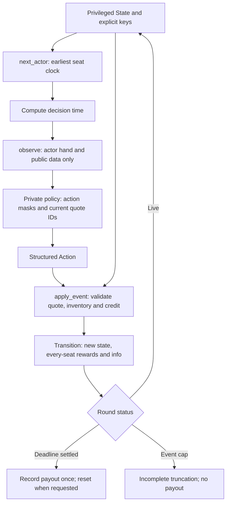

# Standalone engine API

The distribution is `figgie-jax-engine`. Imports use `figgie_jax`. Use a dedicated Python environment.
The standalone engine has no training or server entrypoint.

For a complete compiled batch and execution diagrams, see the
[fully JAX workflow in the README](../README.md#run-the-simulation-loop-fully-in-jax).
The workflow uses only the native engine and JAX policies.

## Private policy loop



The collector owns privileged state. The actor receives only the private
observation. The exchange validates actions after policy selection.

```python
import jax
import jax.numpy as jnp
from figgie_jax.bots import heuristic_policy
from figgie_jax.env import FiggieEnv, next_actor
from figgie_jax.observations import observe
from figgie_jax.types import Config

config = Config(num_players=4, latency_ms=(0, 100, 300, 500))
env = FiggieEnv(config)


@jax.jit
def play_event(state, policy_key):
    actor = next_actor(state)
    at_ms = jnp.maximum(state.time_ms, state.ready_at[actor])
    view = state._replace(time_ms=jnp.minimum(at_ms, config.duration_ms))
    obs = observe(view, actor, config)
    act = heuristic_policy(policy_key, obs, config)
    return env.step(state, act)


state = jax.jit(env.reset)(jax.random.key(7))
result = play_event(state, jax.random.key(8))
print(result.info, result.rewards)
```

Use a new explicit policy key on each event. `State` is privileged: it includes
every hand, deck counts, and the goal. Policies receive only `Observation`.
Observations contain the player's hand, public cash and quotes, the retained
trade history, and remaining time. `features` uses absolute seat references;
`relative_features` relabels public seat references around the observer.
`critic_features` deliberately exposes hidden state for centralized critics.

## State and transitions

`Config` is frozen. Close over it when compiling. The default game has four seats,
240,000 ms duration, a 250 ms decision interval, and zero added latency/jitter.
Use `num_players=5` for five seats. `latency_ms` has one value per seat.
Changing static configuration generally requires compilation again.

`reset(key, config, cash=None)` deals forty cards and deducts the equal ante.
Optional `cash` is the pre-ante bankroll for a later round. `step(state, action,
config)` chooses the next independent clock and executes that opportunity.
`apply_event(state, actor, action, at_ms, config)` accepts an external timestamp.
All return values use fixed-shape JAX arrays. `Transition` contains `state`,
per-seat `rewards`, and public `info`.

Rewards are zero before completion. The true terminal event returns chip profit
relative to pre-ante cash, including the ante and payout once. Deadline events
settle before trading. Completed states are absorbing. Invalid actions consume
an opportunity; backward timestamps do not. The event cap marks `done=True` and
`truncated=True` without a payout. Treat this as an incomplete simulation.
`step` does not auto-reset. Carry unfinished states across rollout boundaries.

## Actions

Use `types.action(kind, suit, price, quote_id)` for host scalars, or construct the
`Action` tuple from scalar integer JAX arrays inside compiled code.

| Kind | Value | Required information |
| --- | ---: | --- |
| WAIT | 0 | None |
| BID | 1 | Suit and integer chip price |
| ASK | 2 | Suit and integer chip price |
| BUY | 3 | Suit and current offer quote ID |
| SELL | 4 | Suit and current bid quote ID |
| CANCEL_BID | 5 | Suit; actor must own bid |
| CANCEL_ASK | 6 | Suit; actor must own offer |

Suit order is spades, clubs, hearts, diamonds, numbered 0 through 3. Quote row 0
is bids and row 1 is offers. Missing quotes have owner -1, price 0, and ID 0.
Every trade transfers one card and clears all quotes. Crossing quotes do not
execute automatically. `action_masks` and `price_mask` use only observable data;
the exchange still checks hidden inventory, credit, and quote freshness.
Prices are integers but cash stays floating point for tied settlement shares.

## Batching and replay

```python
keys = jax.random.split(jax.random.key(9), 32)
states = jax.jit(jax.vmap(env.reset))(keys)
results = jax.jit(jax.vmap(play_event))(states, jax.random.split(jax.random.key(10), 32))
```

Put repeated events in `jax.lax.scan`. See `benchmark.make_rollout` for a compiled
batch loop with a scalar guard around reset work. The benchmark uses independent
fresh bankrolls for new rounds. For cumulative matches, pass the settled cash to
`reset` explicitly. Never reset a live table solely because a scan ended.

`replay.Recorder` stores seed, configuration, initial bankroll, and submitted
events. `Recorder.save(path)` writes JSON. `load_replay(path)` validates bounded
input; `reconstruct(replay)` returns a state and omniscient frames. This is offline
replay, not a live actor input. Recorded checkpoint agent labels do not require
checkpoint files because replay executes the recorded actions.

See [rules and assumptions](rules.md) for the complete fidelity contract.
