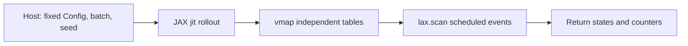

# FiggieJAX Engine on an NVIDIA GPU

This guide covers the standalone `figgie-jax-engine` package. Its compiled
simulation path batches independent tables with `vmap`, advances each table with
`lax.scan`, and compiles the rollout with `jit`:



The event loop, private observations, heuristic decisions, trades, settlement,
and finished-table resets run in JAX. Python handles setup, compilation,
invocation, and output. The bundled benchmark reports engine opportunities. It
does not collect neural trajectories or run a learner or optimizer. The optional
Gymnasium, PettingZoo, and OpenSpiel adapters use host orchestration. A neural
league trainer is not bundled. For a separate modular learner integration
design, see [league-gpu.md](league-gpu.md).
For the educational learner with compiled collection and repeated REINFORCE
updates, see [compiled learning](compiled-learning.md). Use the `test-gpu`
Docker target to run the full test suite with CUDA required.

## Requirements

The package's `gpu` extra and Docker `gpu` target use JAX's CUDA 13 build on
Linux x86-64. Current JAX documentation requires an NVIDIA GPU with compute
capability SM 7.5 or newer and a Linux driver version 580 or newer for CUDA 13.
The host needs a working NVIDIA driver. Docker runs also need the NVIDIA
Container Toolkit configured for Docker. JAX's CUDA wheels provide CUDA
libraries, so a separate host CUDA toolkit is not needed for the package's
standard wheel setup. See JAX's NVIDIA [installation requirements][jax-install]
and NVIDIA's [Container Toolkit setup][nvidia-toolkit].

The repository pins Python 3.12 and dependencies in `uv.lock`. Install the
standalone package in its own environment. The `all` extra installs CPU
framework adapters. It does not enable CUDA.

## Install and verify on Linux

From the engine repository root:

```bash
nvidia-smi
uv sync --locked --extra gpu
JAX_PLATFORMS=cuda uv run --no-sync python -c \
  'import jax; print("backend:", jax.default_backend()); print("devices:", jax.devices())'
```

`JAX_PLATFORMS=cuda` makes GPU initialization mandatory. The check must report
`backend: gpu` and list the NVIDIA device. A CPU backend is not GPU validation.
The benchmark also checks its requested backend and stops if JAX selects CPU.
Use `uv run --no-sync` after syncing with the `gpu` extra. This keeps `uv run`
from removing optional GPU packages from the environment.

Run a short GPU smoke benchmark and save its report under the ignored `results/`
directory:

```bash
mkdir -p results
JAX_PLATFORMS=cuda uv run --no-sync figgie-engine-benchmark \
  --backend gpu --batch 32 --steps 64 --repeats 1 --seed 7 \
  --output results/gpu-smoke.json
```

This confirms that the compiled collector runs on GPU. Its short duration is
not a stable throughput measurement and may complete no rounds.

## Run through Docker

On a Linux x86-64 host with Docker GPU access configured, build the repository's
CUDA 13 image and verify the visible device:

```bash
docker build --target gpu -t figgie-engine:gpu .
docker run --rm --gpus device=0 figgie-engine:gpu
```

The image sets `JAX_PLATFORMS=cuda`; the default command prints JAX devices.
Then run the same smoke workload and write the JSON file to the host:

```bash
mkdir -p results
docker run --rm --gpus device=0 \
  --user "$(id -u):$(id -g)" -e UV_CACHE_DIR=/tmp/uv-cache \
  -v "$PWD/results:/results" figgie-engine:gpu \
  uv run --no-sync figgie-engine-benchmark \
  --backend gpu --batch 32 --steps 64 --repeats 1 --seed 7 \
  --output /results/gpu-smoke.json
```

A Docker Desktop CPU run does not validate CUDA. If the container cannot see
the GPU, first confirm that `nvidia-smi` works on the host and check the NVIDIA
Container Toolkit configuration. Do not treat a failed CUDA start as a
successful CPU fallback.

## Tune table batch size and VRAM

`--batch` is the number of independent tables processed together. Increase it
to use more device parallelism. Larger batches need more device memory and may
stop improving throughput before VRAM is full. `--steps` sets the scan length,
or event opportunities per table in each call. The benchmark does not store a
per-event trajectory. Changing batch size or scan length changes compiled
shapes and requires a new compilation.

Start with the smoke test, then increase batch size in steps. Keep the workload
fixed and run each size in a separate process. Stop at the first out-of-memory
error. Lower the largest size or leave more VRAM headroom if another application
uses the device.

```bash
for batch in 64 128 256 512 1024 2048 4096 8192; do
  JAX_PLATFORMS=cuda uv run --no-sync figgie-engine-benchmark \
    --backend gpu --batch "$batch" --steps 256 --repeats 20 --seed 8 \
    --output "results/gpu-batch-${batch}.json" || break
done
```

Watch usage in a second terminal with `watch -n 1 nvidia-smi`. JAX 0.12.0.1
preallocates 75% of total GPU memory when its first operation runs. A high
`nvidia-smi` reading can therefore show allocator reservation, not the live size
of the game state. For a shared GPU, set the JAX allocator pool fraction. JAX
0.12.0.1 accepts `XLA_CLIENT_MEM_FRACTION`; its source marks
`XLA_PYTHON_CLIENT_MEM_FRACTION` as a deprecated alias. This example sets the
pool fraction to 60% of total GPU memory:

```bash
XLA_CLIENT_MEM_FRACTION=0.60 JAX_PLATFORMS=cuda \
  uv run --no-sync figgie-engine-benchmark --backend gpu \
  --batch 1024 --steps 256 --repeats 20 --seed 8 \
  --output results/gpu-batch-1024.json
```

This configures the JAX/XLA allocator pool. It is not a hard cap on all VRAM
used by the process or device. Leave additional room for CUDA contexts,
libraries, compiler allocations, the desktop, and other GPU users. Do not set
both memory-fraction names at once. Alternatively,
`XLA_PYTHON_CLIENT_PREALLOCATE=false` disables initial reservation, but can
increase fragmentation risk. Avoid running multiple JAX benchmarks at the same
time. See the [JAX GPU memory guide][jax-memory] for allocator options.

## Measure and report throughput

For a longer run, use identical settings and seeds across the batch sizes you
compare. The benchmark compiles and warms the workload once, excludes that call
from measured samples, and synchronizes each measured call. It includes
heuristic decisions, event processing, settlement, and resets. Its rate is total
submitted opportunities divided by measured seconds. Compare the rate together
with peak VRAM, completed rounds, and truncations. Do not select a batch only
because it is the largest one that fits. JAX's [benchmark guidance][jax-bench]
explains compilation and synchronization requirements.

The JSON records JAX/JAXlib versions, the selected device, settings, warm-up
duration, timing samples, throughput, source hashes, and a final-state hash. Also
record `nvidia-smi` output for GPU model, driver version, total VRAM, and any
other GPU workloads. Keep the JSON in ignored `results/`.

The repository has one measured reference point: an RTX 2070 SUPER with
8,192 MiB, Linux x86-64, driver 615.71.09, JAX/JAXlib 0.12.0.1, four players,
batch 8,192, 256 steps, and 100 repeats measured about 48.07 million heuristic
opportunities per second. This is a workload-specific engine measurement, not a
universal GPU limit or neural training rate. See
[engine-performance.md](engine-performance.md) for complete settings and limits.

[jax-install]: https://docs.jax.dev/en/latest/installation.html
[nvidia-toolkit]: https://docs.nvidia.com/datacenter/cloud-native/container-toolkit/install-guide.html
[jax-memory]: https://docs.jax.dev/en/latest/201/gpu-memory.html
[jax-bench]: https://docs.jax.dev/en/latest/benchmarking.html
