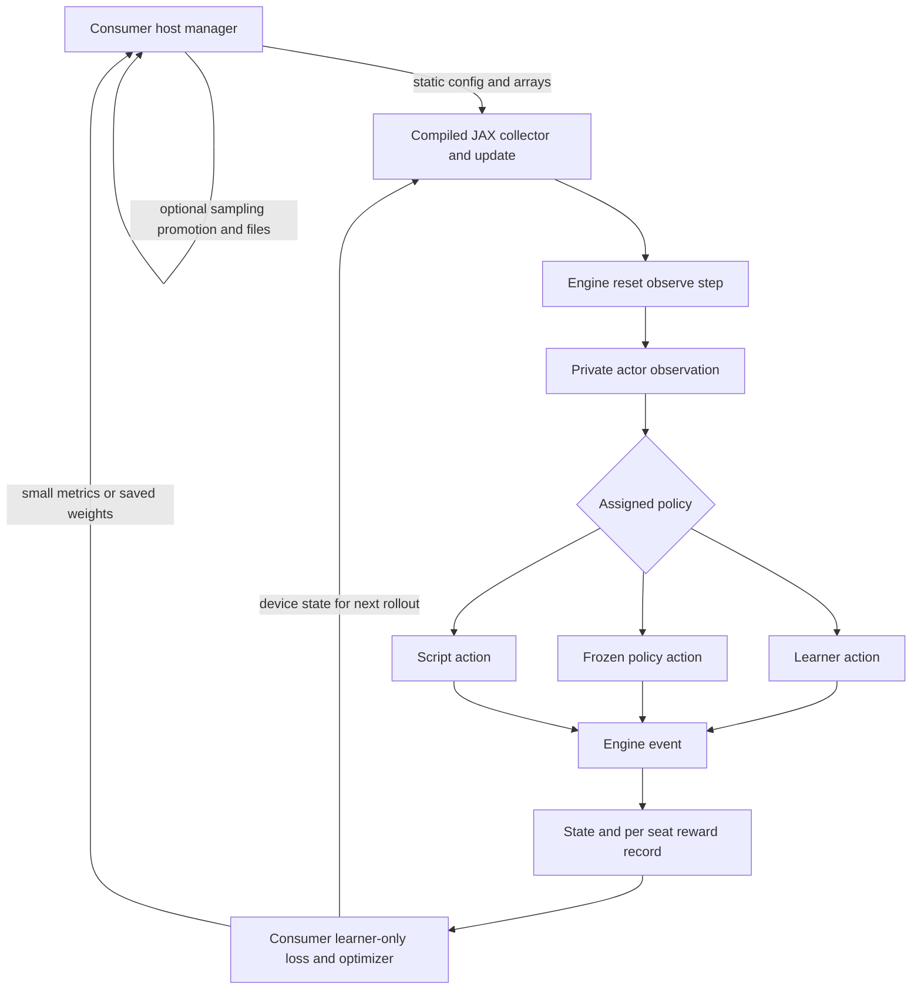

# Design for a GPU resident single learner Figgie league

## Scope

This design uses the standalone FiggieJAX engine in a separate application. The
engine provides transitions, observations, baseline bots, and JAX building blocks.
It does not bundle PPO, league management, a frozen bank, league checkpoints, or a
league CLI. Its REINFORCE example is educational, not a league trainer.

The consumer application owns its optimizer, training loop, opponent population,
checkpoints, evaluation, and run configuration. Keep its source in a separate app
project. That project's environment contains the app and the engine dependency;
it is separate from the engine's own development environment.

See [GPU setup and engine throughput](gpu-throughput.md) for installation and
runnable engine commands. See [the engine API](engine-api.md) for imports, exact
signatures, and decision-time observation handling.

## Engine interfaces

The public API provides the pieces for a collector:

- `Config` fixes game settings, including players, duration, clocks, and event cap.
- `reset(key, config)` creates a round; `next_actor(state)` selects the next seat.
- `observe(state, player, config)` returns that seat's private `Observation`.
  `action_masks` and `price_mask` describe legal choices from that observation.
- `step(state, action, config)` applies the next scheduled opportunity.
  `apply_event` accepts an explicit actor and time. Both return a `Transition`.
- `Action`, `State`, and `Transition` are fixed shape JAX structures.
- `random_policy` and `heuristic_policy` are observation only baseline bots.
- `benchmark.make_rollout` batches heuristic games for engine timing. It does
  not train a policy or manage a league.

`State` is privileged. It contains all hands, deck counts, and the goal. Pass only
`Observation` to each decentralized policy.

## Consumer application modules

Keep learning code in the consumer application. Suggested modules are
`config.py` (static settings), `policy.py` (learner and scripts), `opponents.py`
(frozen bank and sampler), `rollout.py` (JIT, vmap, scan and records),
`training.py` (loss, gradients and optimizer), `evaluation.py` (seeded checks),
`checkpoints.py` (application-owned format and hashes), and `cli.py` (host control).
These are design suggestions, not modules or commands supplied by the engine.

Keep `Config` static during compiled work and pass explicit random keys. Use
`vmap` for independent tables and `lax.scan` for repeated events. Keep host
conversion, file I/O, and Python list operations outside the compiled event loop.

## Batch and role layout

Use the leading axis for independent games. A collector can carry game state
`[env, ...]`, learner seat `[env]`, opponent IDs `[env, player]`, learner memory
`[env, hidden]`, opponent memories `[env, player, hidden]`, and event records
`[time, env, ...]`.

Assign exactly one learner seat to each game. Draw its seat uniformly at round
start. Draw frozen or scripted opponents for the other seats. Hold all roles
fixed until that round ends. Shared learner weights do not mean shared keys,
observations, or recurrent state.

At every event, select the scheduled seat with `next_actor`, form its observation
at that seat's decision time, call its policy, then apply the action with `step`
or `apply_event`. Keep the engine's asynchronous clocks. Carry live games across
rollout boundaries. Reset only completed rounds and their memories.

## Frozen policies and scripted opponents

Represent the neural opponent bank as a fixed shape pytree with a leading
capacity axis. Keep occupancy, stable policy IDs, and per-policy observation
metadata alongside it. Pass this bank separately from learner parameters and
optimizer state. The optimizer owns only the learner parameters. Never apply
optimizer updates or gradients to frozen weights.

The engine's `random_policy` and `heuristic_policy` can act as scripted opponents.
A consumer can add other observation only JAX functions. Give scripts IDs outside
the neural bank and select them with JAX control flow such as `lax.switch`. Every
branch must return the same action structure. Scripts have no checkpoint tensors.

For neural inference, either gather each seat's assigned weights or evaluate
multiple bank policies over a bounded chunk and select the assigned result.
Gathering can reduce extra network work; evaluating a bank chunk can reduce
repeated weight copies. Chunking limits temporary arrays. The tradeoff depends on
bank size, model, batch, and device memory. Measure the chosen path on the target
hardware. Larger capacity can add work even when slots are unoccupied.

## Private memory and terminal rewards

Give each policy only its own observation and memory. Keep learner memory per
environment and opponent memory per environment and seat. Reset memory at round
end, not at a scan boundary. Never reuse one policy's hidden state for another.

Engine rewards are zero before settlement. The transition that completes a round
returns a per-seat terminal chip-profit vector, including ante and payout once.
Settlement can happen on an opponent's event. Record the learner's reward
component after every transition, not only after learner actions. A truncated
round has no terminal reward; report it as incomplete and exclude it from
completed-round targets.

Keep this engine reward contract intact. If the learner uses another timing or
shaped objective, implement and document that transformation in the application.
Keep raw terminal profit available for evaluation and reporting.

## Compiled update and host control

A consumer-owned update can compile rollout collection, inference, loss and
gradient calculation, optimizer steps, and metric accumulation. Keep learner
parameters, optimizer state, live tables, keys, memories, and the frozen bank on
the selected JAX device between updates. Synchronize before timing a full update.
Transfer compact metrics or saved weights to the host when needed.

An optional host sampler such as prioritized fictitious self-play (PFSP) can
weight opponents using evaluation scores, choose
probabilities, and pass them into compiled work. Keep opponent IDs fixed within a
round. Evaluation scheduling, promotion decisions, checkpoint writes, manifests,
and hashing also belong to the application. Replace a bank slot only at a safe
boundary, after every live round using it has finished. Sampling and promotion
rules are application choices, not engine behavior.

Record the learner algorithm, value target, loss mask, sequence length, opponent
sampler, promotion test, evaluation panel, and seeds. Event throughput alone does
not establish learning quality.

## Tune the application for throughput

These are application settings to implement, not engine CLI options:

| Setting | Meaning | Memory and measurement consequence |
| --- | --- | --- |
| Environment batch | Independent games processed together | More live states and policy memories; increase gradually |
| Rollout length | Events collected before an update | More trajectory storage and recurrent activations |
| Sequence minibatch | Whole game sequences processed by the learner | Larger gradient temporaries; changes the optimization schedule |
| Inference chunk | Seat observations evaluated in one neural batch | Bounds temporary candidate outputs and weight gathers |
| Bank capacity | Maximum resident frozen networks | More weights and possibly more candidate inference work |
| Model and memory size | Network width and recurrent state per seat | More parameter, activation, and per-game memory |

Load weights once on the host, then use `jax.device_put` to place the parameter
pytrees and live data on the chosen GPU before compilation. Carry the returned
device arrays between calls. Check each array's `devices()` after a compiled
update; do not infer placement from the existence of a visible GPU alone.
Do not load checkpoints or convert arrays to NumPy inside event collection.
Scripted JAX functions compile into device work; they are not Python agent
processes or neural checkpoint banks.

Keep recurrent sequences contiguous. If using PPO, mask the actor loss to learner
decisions while retaining rewards from opponent events. Preserve live memory
across rollout segments. Choose and document how sequence-boundary memory is
handled when learner weights change.

Start small, then sweep one setting at a time in fresh processes. Keep game rules,
model, seeds, opponent mixture, reward semantics, and evaluation workload fixed.
Exclude compilation and synchronize the complete update with
`jax.block_until_ready`. Repeat promising cases long enough to include settlement
and resets. Leave VRAM headroom for evaluation and temporary allocations. Measure
both update speed and complete-run elapsed time, including host work. The largest
batch that fits is not necessarily the fastest. There is no universal maximum
configuration, and the engine does not supply automatic league tuning or
multi-GPU distribution.

## Setup and implementation sequence

Create a separate uv application project. Declare the standalone engine as a
dependency, then add the optimizer and training libraries selected for the
application. Configure a compatible JAX GPU environment for the target Linux
NVIDIA host. Keep the application's environment and lockfile separate from the
engine package environment. The engine's own `uv sync --locked` setup and Docker
tests validate the engine package, not a consumer trainer.

1. Build one round with a learner and fixed heuristic opponents. Check actor
   scheduling, masks, quote IDs, and terminal reward collection.
2. Batch games with `vmap`. Add learner seats, opponent IDs, keys, and private
   memories per game and seat.
3. Add `lax.scan` event collection. Keep rounds live across scans and reset only
   completed games.
4. Add fixed shape policy trees. Check device placement and assert that frozen
   bank values stay unchanged through updates.
5. Add the learner optimizer. Then add host sampling, evaluation, safe snapshots,
   and application-owned checkpoint handling.
6. Record engine and app versions, seeds, game settings, batch shapes, model and
   optimizer settings, device, reward handling, and opponent identities.

## Architecture sketch

