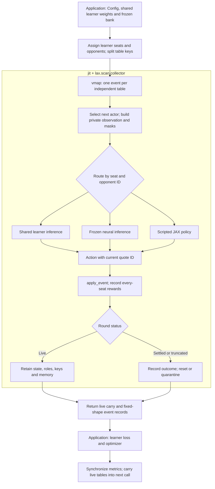

# Collect parallel Figgie tables for learning

This guide describes an application-owned collector for many independent
four-seat or five-seat Figgie tables. It uses `vmap` across tables, `lax.scan`
across event opportunities, and `jit` around the fixed-shape collector.
The engine supplies game transitions and private observations. It does not
provide this general streaming collector or a frozen opponent bank. The bounded
[compiled learning example](compiled-learning.md) instead collects complete
independent rounds and applies educational REINFORCE updates.

For the exact engine API, see [engine API](engine-api.md). For GPU setup and
engine-only measurements, see [GPU throughput](gpu-throughput.md). For a
broader optional league design, see [league GPU design](league-gpu.md).

## Batch and role state

Let `B` be the number of independent tables, `N` be `Config.num_players` (4 or
5), `T` be the number of event opportunities collected per call, and `M` be the
recurrent memory width, if the policies use memory. Keep these values and
`Config` fixed for a compiled call. A typical application carry contains:

| Value | Leading shape | Purpose |
| --- | --- | --- |
| Engine states | `[B, ...]` | One independent `State` per table |
| Learner seat | `[B]` | One seat index per table and round |
| Opponent IDs | `[B, N]` | Frozen neural policy or script assigned to each seat |
| External policy keys | `[B, ...]` | Independent learner and opponent sampling streams |
| Policy memory | `[B, N, M]` | Private memory for each policy at each seat |
| Learner parameters | Shared pytree | The same trainable policy is evaluated in every table |
| Frozen bank | Application-owned pytree | Inference-only neural opponent parameters |

The engine also carries a distinct PRNG key inside each `State`. It uses that
key for game scheduling and timing draws. Keep application policy keys separate
from engine keys. Split keys by table, event, and policy role. Do not reuse one
sample key across tables or seats.

At a round boundary, assign one learner seat to each table, for example by a
uniform draw from `0` through `N - 1`. Assign frozen neural opponents or scripted
policies to the other seats. Keep these assignments fixed for the full round.
When a table is replaced after it ends, draw new roles and reset its memories.
If the policy uses seat-relative features, `relative_features` rotates public
seat references so the acting seat has relative index zero.

Shared parameters do not imply shared game state. Each table has its own deal,
clock schedule, quote IDs, role assignment, random keys, and recurrent memory.
The optimizer must update only learner parameters. Keep the frozen bank outside
the optimizer's parameter tree; do not differentiate through or apply updates
to its weights. The engine's `random_policy` and `heuristic_policy` are usable
scripts. A fixed or random policy in the learner seat can check routing, but it
is not training unless an application computes a learning objective and updates
parameters from it.

### More than one learning seat

The pseudocode below uses one learning seat per table. For multiple learning
seats, replace `learner_seat[B]` with a Boolean assignment mask `[B, N]`. Route
the scheduled actor through the learner when that actor's mask entry is true.
Shared learner parameters can serve all assigned seats. Each seat still needs
its own private observation, key stream, memory, trajectory identity, and reward
component. Hold the assignment mask fixed throughout each round. Frozen or
scripted opponents occupy the remaining seats. A table always has exactly four
or five total seats, regardless of the number that learn.

Store the entire reward vector and attribute each component to its seat's
trajectory. Mask actor losses to learning-seat decisions. If several seats
share parameters, combine their losses in the application and apply one shared
optimizer update. Do not sum all seats' profit into one reward: settlement is
zero-sum, so that sum removes the learning signal. If seats use different
learners, the application must keep their parameter and optimizer trees separate.

## One event per table in each scan step

`vmap` makes one event transition for each table in the batch. It does not make
seats within a table act simultaneously. For each table, `next_actor(state)`
selects the seat with the earliest independent clock and uses the state's seeded
tie-break. Build that actor's observation with `observe`. The observation must
be the only game input to a decentralized policy. Do not pass `State`, which
contains every hand, the deck, and the hidden goal.

Build legal choices from the observation. `action_masks` returns action-kind and
conditional suit masks. `price_mask` constrains quote prices. A `BUY` action
must carry the currently observed ask ID (`quote_ids[1, suit]`); `SELL` must
carry the currently observed bid ID (`quote_ids[0, suit]`). Quote IDs can become
stale, and the engine checks them again. The exchange also checks hidden
inventory and configured credit rules, so an observation mask cannot guarantee
that every attempted trade will succeed.

The next opportunity time is `max(state.time_ms, state.ready_at[actor])`. Build
the policy observation from a state view with `time_ms` advanced to that opportunity, as
in the compiled README example. If the opportunity is at or beyond the deadline,
call `apply_event` with a `WAIT` action to trigger settlement; the deadline event
settles before any trade. No actor decision is needed at that point.

The following pseudocode shows the data flow. Routing, key splitting, record
packing, and selective reset functions are application helpers. This is not
runnable code or an engine API. In an actual
JAX implementation, policy routing uses `lax.cond` or `lax.switch` with
same-shaped outputs, and the scan carry and per-event records use fixed-shape
pytrees.

```python
# Application-owned pseudocode; this does not implement training.
def one_table_event(state, learner_seat, opponent_ids, memory, event_key):
    actor = next_actor(state)
    at_ms = jnp.maximum(state.time_ms, state.ready_at[actor])
    view = state._replace(time_ms=jnp.minimum(at_ms, config.duration_ms))
    obs = observe(view, actor, config)

    kind_mask, suit_mask = action_masks(obs, config)

    # Do not run an actor at the deadline. WAIT makes apply_event settle first.
    def decide(_):
        # route_policy uses shared learner_params when actor == learner_seat.
        # Otherwise it routes opponent_ids[actor] to frozen-bank inference or a
        # scripted JAX policy. It applies price_mask after choosing kind/suit,
        # then returns an Action and updated actor memory.
        return route_policy(
            learner_params,
            frozen_bank,
            opponent_ids[actor],
            actor == learner_seat,
            obs,
            kind_mask,
            suit_mask,
            memory[actor],
            event_key,
        )

    act, actor_memory = jax.lax.cond(
        at_ms >= config.duration_ms,
        lambda _: (action(Kind.WAIT), memory[actor]),
        decide,
        operand=None,
    )
    transition = apply_event(state, actor, act, at_ms, config)
    next_memory = memory.at[actor].set(actor_memory)
    learner_reward = transition.rewards[learner_seat]
    learner_turn = (actor == learner_seat) & (at_ms < config.duration_ms)
    record = pack_event(
        obs,
        act,
        kind_mask,
        suit_mask,
        actor,
        learner_turn,
        transition.rewards,
        learner_reward,
        transition.state.done,
        transition.state.done & ~transition.state.truncated,
        transition.state.truncated,
    )
    return transition.state, next_memory, record


def scan_step(carry, _):
    states, learner_seats, opponent_ids, memories, policy_keys = carry
    policy_keys, event_keys, reset_keys, role_keys = split_table_keys(policy_keys)

    next_states, memories, events = jax.vmap(one_table_event)(
        states, learner_seats, opponent_ids, memories, event_keys
    )
    # done is true for both settlement and event-cap truncation.
    finished = next_states.done
    # Record each outcome before replacing its state. Recycle finished tables
    # only; a live round and its assignments and memory continue unchanged.
    fresh_states = jax.vmap(lambda key: reset(key, config))(reset_keys)
    states = select_tree(finished, fresh_states, next_states)
    learner_seats, opponent_ids = reset_roles_where_finished(
        finished, role_keys, learner_seats, opponent_ids
    )
    memories = reset_memory_where_finished(finished, memories)
    return (states, learner_seats, opponent_ids, memories, policy_keys), events


# Application-owned wrapper: jit the scan and keep its carry for the next call.
def collect(initial_carry):
    return jax.lax.scan(scan_step, initial_carry, None, length=T)


compiled_collect = jax.jit(collect)
```

This example recycles event-cap truncations so the batch can continue. A
consumer may instead stop or quarantine a truncated table. In either case,
record it as incomplete. The event cap sets `done=True` and `truncated=True`,
but does not settle the pot and returns no terminal reward. It must not enter
completed-round targets or completed-game statistics. A true settlement has
`done=True` and `truncated=False`.

The reset above starts fresh-bankroll rounds. For a cumulative match, pass the
settled table's final cash to `reset(..., cash=...)` as intended by the
application. Do not reset a live state at the end of a scan or collection call.
Carry live states, keys, roles, and policy memory into the next call.

## Rewards, trajectory records, and memory

`Transition.rewards` is a vector with one value per seat. Rewards are zero until
settlement. The transition that settles the table returns every seat's terminal
chip profit relative to its pre-ante cash, including trade transfers, the ante,
and payout once. Settlement can happen on an opponent's event. Record the full
reward vector after every event and select the learner component with
`transition.rewards[learner_seat]`. Do not collect reward only when the learner
acts, and read the transition before resetting its table state.

Store fixed-shape event rows such as observations, actions, masks, actor IDs,
learner-turn masks, reward vectors, settled flags, and truncation flags. Use the
learner-turn mask to identify which actions came from the trainable policy.
Keep reward events even when the actor was an opponent. The learning algorithm
defines how the event rewards map to learner actions and value targets; the
engine does not define that credit-assignment rule. Keep truncated episodes
marked as censored and exclude them from targets that require a terminal result.

For recurrent policies, use separate memory for each table and seat. Update the
memory belonging to the scheduled actor. Keep memory across scan boundaries,
and clear it when that table's round ends. If learner weights change while a
round remains live, choose and document how to handle memory computed by the old
weights: reset it, recompute it from the retained sequence, or use an algorithm
that explicitly permits the carry. The engine does not choose this policy.
Keep opponent memory separate from learner memory. For feed-forward policies,
omit memory from the carry.

## Mermaid collection flow



The optimizer and the policy update in this diagram belong to the consumer
application. The engine does not implement either one.

## Tune memory and measure the full workload

Increase table batch size gradually. More tables increase state, keys, role
arrays, and recurrent memory. Longer scans increase the number of stored event
rows if the collector returns trajectories. Observation and action-mask records
can use more memory than simulator states. Store only fields the learner needs,
use compact dtypes where correct, and collect in shorter chunks when trajectory
storage limits the batch. A smaller inference chunk can also bound temporary
arrays when evaluating a large frozen policy bank. Gathering only assigned
opponent weights and evaluating a bank chunk trade weight traffic against extra
inference work; measure both choices on the target device.

`jit` compiles for the fixed configuration and array shapes. A change in player
count, batch size, scan length, model shape, bank capacity, or inference chunk
can trigger another compilation. Keep configuration and host I/O outside the
event loop. Keep game states, parameters, memories, and keys on the selected JAX
device when possible.

For timing, compile and warm up first. Then synchronize the complete result with
`jax.block_until_ready` before stopping the timer. Report at least tables,
events per table, scan length, model and bank sizes, memory use, completed
rounds, truncations, and hardware. Measure the full application update when
reporting learning throughput: include the work that matters to that claim,
such as neural inference, trajectory writes, loss, gradients, optimizer work,
and required host operations. `benchmark.make_rollout` measures an engine
workload with a heuristic policy and counters. It does not retain a learner
trajectory, use a neural policy bank, compute gradients, or run an optimizer.
Its opportunities-per-second rate is not learning throughput.

Throughput does not establish learning quality. Evaluate the updated learner on
separate seeded games. Balance learner seats, keep the evaluation opponent mix
and game settings explicit, report completed games and truncations, and compare
terminal profit or other declared measures across enough runs to describe their
uncertainty. These are simulated outcomes. Do not present an engine benchmark
or a parameter update as evidence of strategic strength.
